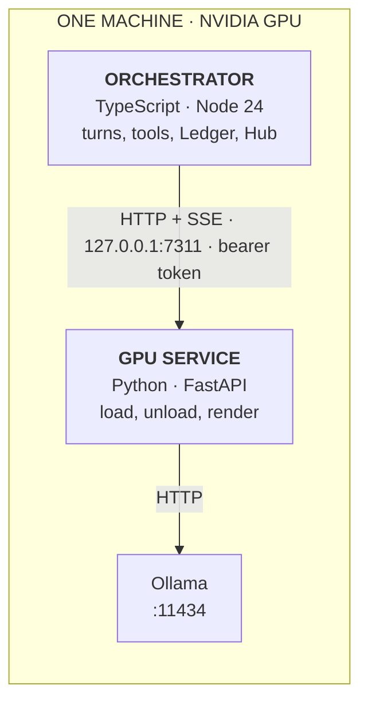
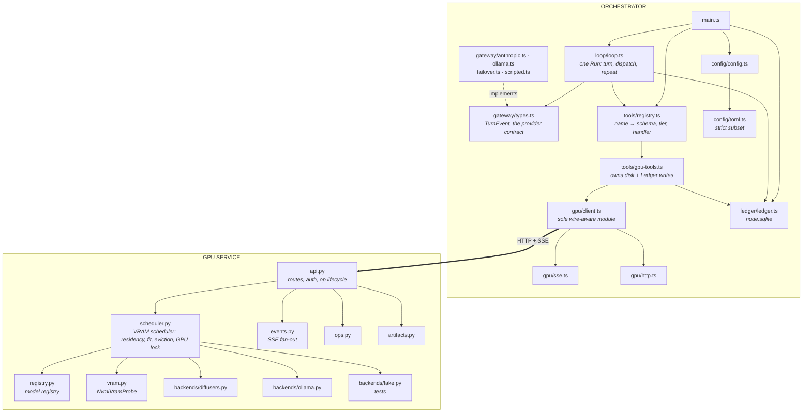
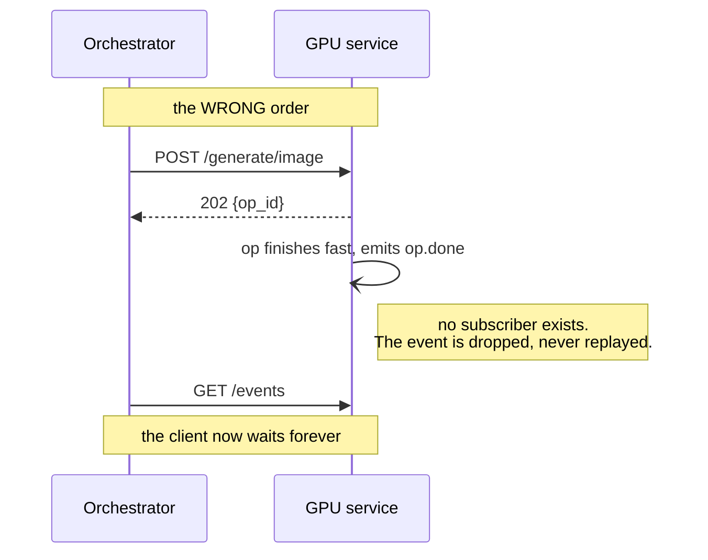
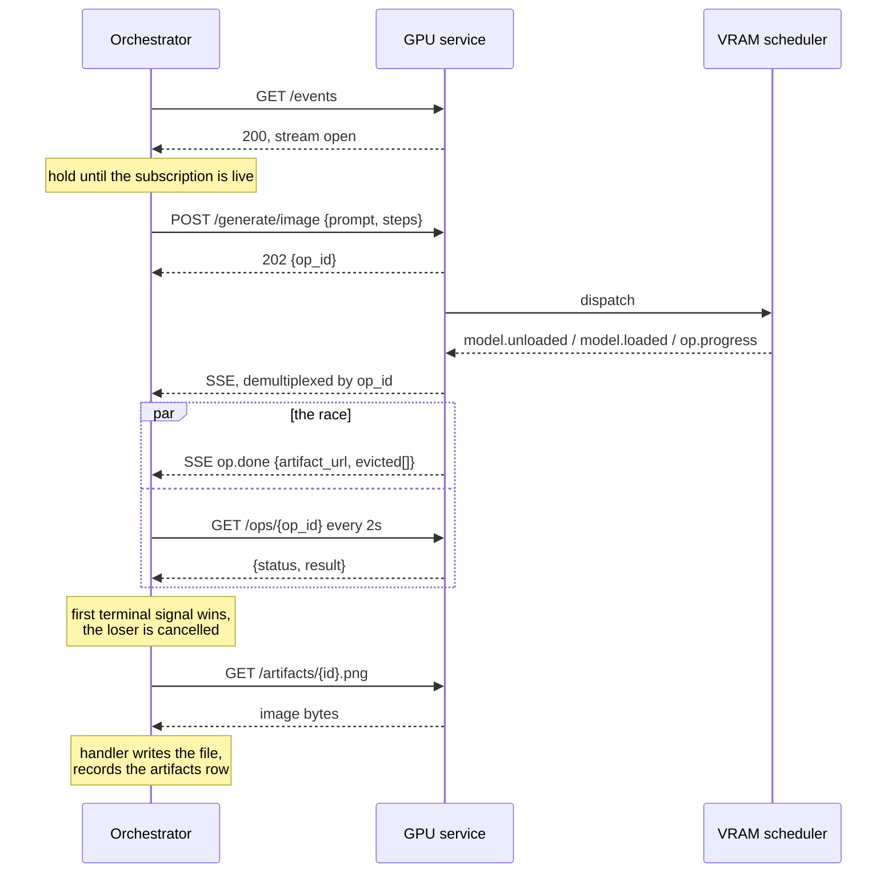
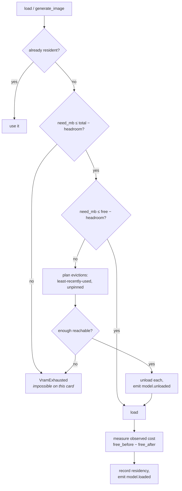
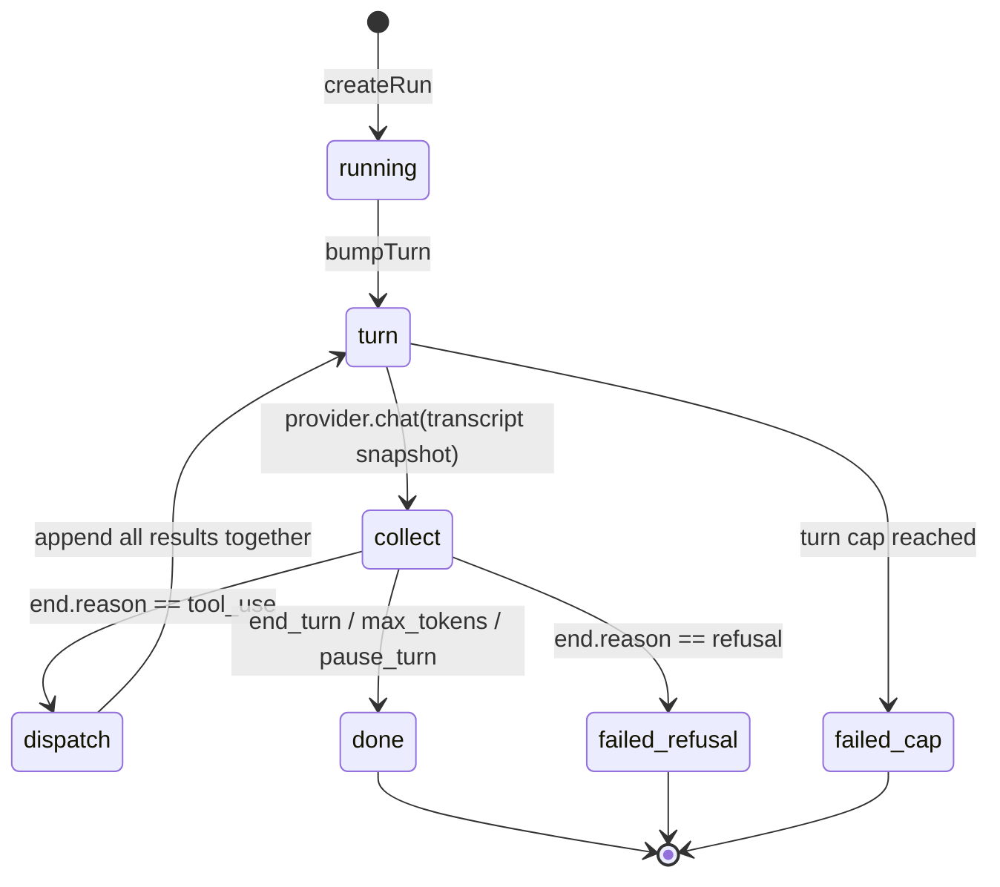
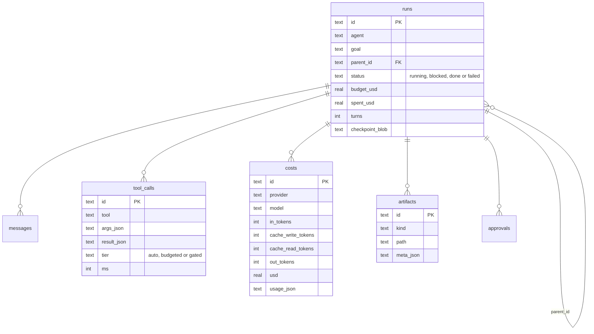

# Architecture

How OpenHybridHarness fits together, and why several parts are shaped the way
they are rather than the obvious way. Diagrams are Mermaid, which renders on
GitHub and in most editors.

---

## 1. The split



**Why two processes, two languages.** `torch` and `diffusers` are Python-only,
and a resident pipeline cannot be shelled out to per call without re-paying a
multi-gigabyte load each time. The orchestrator wants streaming ergonomics and
first-party model SDKs. They meet at an HTTP boundary, so the polyglot seam has
no ongoing cost.

**Why VRAM is not fungible.** A model resident on the card cannot serve anything
else until it is unloaded. The GPU service is therefore a *scheduler*, not
merely a loader.

**Why loopback, with a token anyway.** Both processes run on one machine, so the
service binds `127.0.0.1` and the orchestrator reads its address from the model
registry (`models.toml`). The bearer token is still required: the service loads
and executes models on request and must never be reachable unauthenticated, even
if someone later changes the bind address.

---

## 2. Components



Two boundaries are load-bearing and worth stating plainly:

- **`gpu/client.ts` touches neither the filesystem nor the Ledger.**
  `fetchArtifact` returns bytes; `tools/gpu-tools.ts` decides where they live
  and writes the row. That is what keeps "sole wire-aware module" true, and what
  lets the client be tested against a stub server with no disk and no database
  in play.
- **The VRAM scheduler is the only thing that decides what is resident.** Ollama
  has its own idle timer; the GPU service loads with `keep_alive=-1` so it never
  fires, and the scheduler's own idle sweep (`idle_unload_s`, default 30 min)
  returns the card, so there is one source of truth rather than two.

---

## 3. The op protocol

The subtlest part of the system.

`POST /load` and `POST /generate/image` return `202` with an `op_id`; the work
happens asynchronously and progress arrives on a **global** SSE stream carrying
every op's events. The obvious client — post, then subscribe — is wrong:



The GPU service's own test suite asserts both halves of that trap:
`test_events_emitted_before_subscribing_are_not_replayed` and
`test_full_queue_drops_the_oldest_event`. So a terminal event can be missed
either by subscribing late *or* by a full queue under load.

What `GpuClient` actually does:



The poll is deliberately slow. It is a **backstop against a dropped event, not
the mechanism** — the SSE path is what the architecture is for.
`test/gpu-client.test.ts` drops `op.done` on purpose and asserts the op still
completes, so the backstop is proven rather than assumed.

---

## 4. The scheduler's decision

Every GPU operation runs behind a single lock. One GPU, one queue, one operation
at a time — concurrent loads are the fastest route to an OOM.



Two different questions, two different formulas, and conflating them is a bug:

| Question | Formula |
|---|---|
| *Is this model impossible on this card?* | `total − headroom` — a permanent property |
| *Do I need to evict right now?* | `free − headroom` — changes when a game opens |

On the 12 GB RTX 3060 it was developed against: `12288 − 768 = 11520` capacity,
against measured costs of `sdxl-turbo` **7515 MiB** and `qwen2.5-coder:7b`
**4870 MiB** — **12385** together. Those two models cannot coexist, so every
image generation evicts the coder. That is the scheduler working, not failing.

---

## 5. A Run's turn cycle



- **`refusal` is a terminal reason, not an exception.** A safety classifier
  declining a request returns HTTP 200 with `stop_reason: "refusal"`. Modelling
  it as a throw would make an ordinary response look like a transport failure.
- **Tool results go back together.** One assistant message may carry several
  `tool_use` blocks; splitting the results across messages teaches the model to
  stop asking in parallel.
- **The provider gets a transcript snapshot, not the live array.** Handing over
  the live one let later turns mutate what an earlier request had already been
  given — caught by a test, and every streaming adapter would have hit it.
- **The turn cap marks a Run `failed`, not `blocked`.** `blocked` promises that
  a resume will pick the work back up, and a status that lies about being
  recoverable is worse than one that is blunt.

---

## 6. The Ledger

`node:sqlite`, one file, six tables.



A migration runner arrives when a column first *changes*, not when a table is
first *used*.

**Why `costs` has four token buckets.** The Claude API reports usage in four
buckets at three prices, and a cache read costs roughly **0.1×** a fresh input
token. Collapsing them into one input figure overstates a cache-heavy turn by
about **10×** — and the budget spends that figure, it is not just a report. A
`$2.00` agent would have hit `blocked` at around 20¢ of real spend. `usage_json`
keeps the raw evidence, so a wrong price table can be re-derived rather than
having been discarded.

---

## 7. Risk tiers

Every tool carries a tier, because agents act without the operator in the loop.

| Tier | Meaning | Examples | Behaviour |
|---|---|---|---|
| `auto` | free, reversible | `gpu_status`, `fs.read` | runs immediately |
| `budgeted` | costs money or GPU time | `gpu_generate_image`, cloud calls | runs, debits the Run, blocks at cap |
| `gated` | irreversible or outward-facing | `publish`, `git push`, deploy | blocks pending operator approval |

`tool_calls.tier` is written on every call. A `gated` call stops the Run before
anything runs, writes an `approvals` row, and the Run resumes from its
checkpoint once an operator answers; a denial comes back to the agent as a
result it must handle, not as a failure.

---

## 8. Findings that changed the design

Each of these was measured, not reasoned about.

### `torch.cuda.mem_get_info()` cannot see other processes

The scheduler's original probe answered *"how much can this CUDA context still
allocate?"*, not *"what is on the device?"*. Under Windows' WDDM model the OS
hands each process a pageable budget, so another process's resident weights are
never subtracted. Measured with the GPU service idle:

```
            nvidia-smi      nvml     torch
[before]       10716       10715     11253
[after ]        5845        5844     11253     ← Ollama loaded 4871 MiB
[consumed]      4871        4871         0
```

Zero. The `max(1, …)` floor in `_attempt_load` then booked that model at **1
MiB**, so the scheduler never planned an eviction and the card overcommitted to
77 MiB free holding two models that provably cannot coexist. This was not an
edge case: the GPU service's own Ollama is *always* a separate process, so it
was the default path for every code model. The probe now reads NVML, which
agrees with `nvidia-smi` to within 1 MiB, and the GPU service **refuses to
start** if NVML is unavailable.

### Ollama frees VRAM after it acknowledges the unload

`keep_alive=0` is an instruction, not a completion. A scheduler probing the
moment `unload()` returned read a card that had not given the memory back, and
emitted a `vram.changed` event claiming to free 4871 MiB while reporting no
additional free memory — internally inconsistent, because `freed_mb` comes from
the stored residency while the figures come from a live probe.
`OllamaBackend.unload` now polls `/api/ps` until the model is gone, bounded and
non-raising.

### Measuring after an eviction understates the cost

With the above fixed, a model loaded straight after an eviction still books
**7084 MiB** against **7515** measured on a clean card — about 5.7% short, and
unexplained. The working hypothesis is PyTorch's caching allocator serving part
of the load from blocks it had already reserved, which a free-memory delta
cannot see. `models.toml` holds the clean figure.

---

## 9. Local inference goes through the GPU service

Local inference routes orchestrator → GPU service → Ollama, never orchestrator →
Ollama. Ollama auto-loads whatever model a request names — that is how
`OllamaBackend.load` works — so a direct call books VRAM the scheduler never
planned and bypasses it entirely. Ollama therefore stays on `127.0.0.1:11434`,
and the `ollama` provider speaks the GPU service's `POST /generate/text`, which
carries tokens out as `op.token` events and tool calls in both directions so the
free provider can drive the loop.
